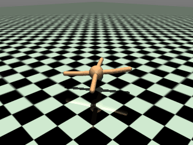
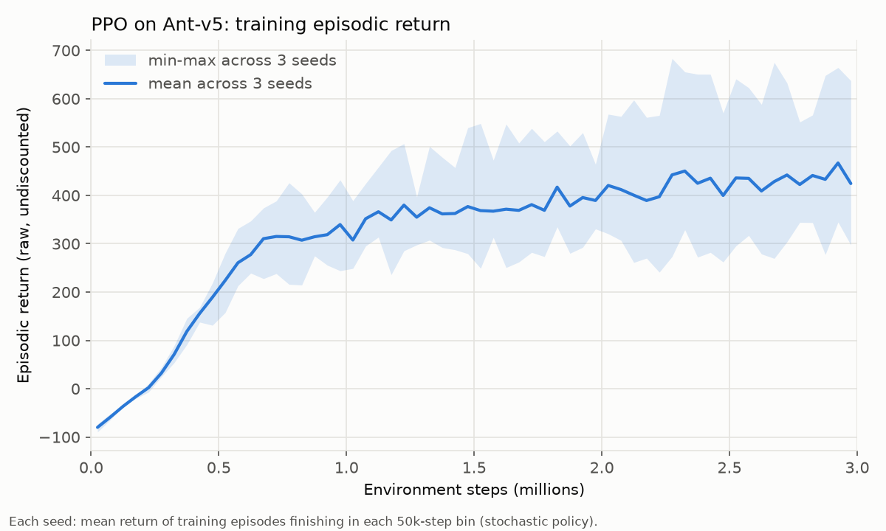

# PPO on MuJoCo Ant-v5

PPO from scratch in PyTorch, trained on Gymnasium `Ant-v5`.



## Run

```bash
conda env create -f environment.yml
conda activate ppo-ant
MUJOCO_GL=egl python ppo_ant.py --seeds 1 2 3 --total-steps 3000000 --out runs
```

This trains the three seeds in parallel, then evaluates them and writes `return_curve.png`, `ant_walk.gif` and `runs/summary.json`. To re-run only evaluation, plotting and the GIF from saved checkpoints, add `--skip-train`.

## Learning curve


